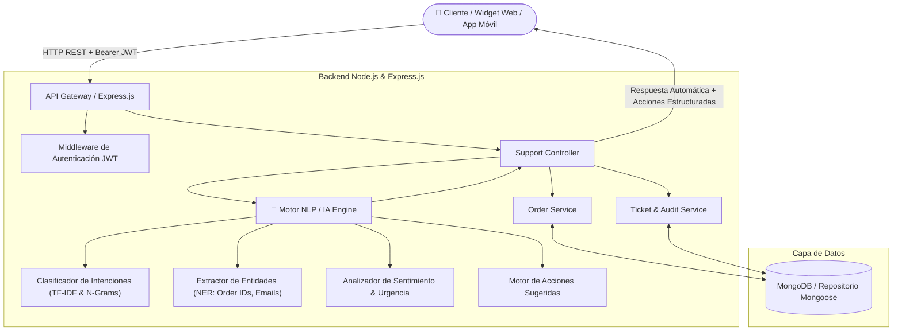

# CASO 2: API Inteligente para Soporte al Cliente (E-Commerce)

Solución integral y producción-ready de una **API REST impulsada por Inteligencia Artificial y Procesamiento de Lenguaje Natural (NLP)** diseñada para automatizar la atención al cliente en plataformas de comercio electrónico.

---

## 📋 Contexto y Problemática

Una empresa de comercio electrónico recibe diariamente miles de consultas recurrentes que sobrecargan al equipo humano de soporte:
* *"¿Dónde está mi pedido?"* (Rastreo logístico en tiempo real)
* *"Quiero devolver un producto"* (Gestión de devoluciones, políticas de reembolso y generación de guías)
* *"No funciona mi compra"* (Diagnóstico técnico, reclamos de avería y garantías)

El equipo de atención tradicional no escala al ritmo del volumen de ventas. La solución implementada es una **API REST inteligente** que interpreta automáticamente las consultas mediante NLP, consulta la base de datos de órdenes y clientes, y responde en milisegundos con acciones sugeridas y tickets trazables.

---

## 🏛️ Arquitectura General



---

## 🛠️ Tecnologías Utilizadas

* **Entorno de Ejecución:** Node.js v22+
* **Framework Web:** Express.js 4.x
* **Procesamiento de Lenguaje Natural (IA/NLP):** Motor propio en español con tokenización, lematización, clasificación multi-clase ponderada, extracción de entidades nombradas (NER: regex semántico de órdenes `#PED-XXXX`), análisis de sentimiento y conector para LLMs externos (OpenAI/Gemini).
* **Base de Datos:** MongoDB con **Mongoose** (incluye adaptador de respaldo en memoria automático para pruebas locales sin requerir servicios externos).
* **Seguridad y Autenticación:** JSON Web Token (`jsonwebtoken`) con contraseñas encriptadas con `bcryptjs` y control de acceso basado en roles (**RBAC**: `customer`, `agent`, `admin`).
* **Pruebas Automatizadas:** Node Test Runner nativo + `supertest`.

---

## 📂 Estructura del Proyecto

```text
CASO_B/
├── .env                  # Variables de entorno configuradas
├── .env.example          # Plantilla de variables de entorno
├── package.json          # Metadatos del proyecto y dependencias
├── public/
│   └── index.html        # Simulador interactivo en vivo con chat y panel de inspección de IA
├── src/
│   ├── app.js            # Configuración de Express, CORS y middlewares
│   ├── server.js         # Entrada principal del servidor HTTP
│   ├── config/
│   │   ├── env.js        # Carga de variables de entorno
│   │   └── database.js   # Conexión Mongoose con fallback a memoria
│   ├── controllers/
│   │   ├── authController.js    # Registro, Login y Me con JWT
│   │   ├── orderController.js   # Consulta de pedidos y rastreo
│   │   └── supportController.js # Procesamiento de consultas con IA y tickets
│   ├── database/
│   │   └── seed.js       # Semilla con usuarios, órdenes y FAQs de prueba
│   ├── middlewares/
│   │   ├── authMiddleware.js    # Validación estricta y opcional de JWT
│   │   ├── roleMiddleware.js    # Control de roles (RBAC)
│   │   └── errorHandler.js      # Manejador centralizado de errores
│   ├── models/
│   │   ├── User.js          # Modelo de usuarios y roles
│   │   ├── Order.js         # Modelo de pedidos, rastreo y garantías
│   │   ├── Ticket.js        # Modelo de tickets de atención auditables
│   │   └── KnowledgeBase.js # Modelo de artículos FAQ
│   ├── routes/
│   │   ├── authRoutes.js    # Rutas /api/auth
│   │   ├── orderRoutes.js   # Rutas /api/orders
│   │   ├── supportRoutes.js # Rutas /api/support
│   │   └── index.js         # Agrupador de rutas y healthcheck
│   └── services/
│       ├── nlpService.js     # Motor central de IA, NLP, NER y Sentimiento
│       ├── orderService.js   # Lógica de negocio para órdenes
│       └── supportService.js # Orquestador de atención y tickets
└── tests/
    └── support.test.js       # Suite de pruebas automatizadas unitarias y HTTP
```

---

## 🧠 Funcionamiento del Motor de Inteligencia Artificial (NLP)

El motor procesa cada consulta mediante una tubería de 4 etapas:

1. **Normalización y Tokenización:** Convierte a minúsculas, elimina signos de puntuación respetando identificadores de pedido (`#PED-1001`), neutraliza tildes en español y filtra *stopwords*.
2. **Clasificación de Intenciones (*Intent Detection*):**
   * `order_tracking`: "¿Dónde está mi pedido?", "Rastrear mi compra", etc.
   * `order_return`: "Quiero devolver un producto", "Solicito reembolso", etc.
   * `product_issue`: "No funciona mi compra", "Vino roto", "No prende la pantalla", etc.
   * `order_cancellation`: "Cancelar compra", "Anular mi orden", etc.
   * `shipping_info`: "Tiempos de entrega", "Costos de flete", etc.
   * `human_handoff`: "Hablar con un asesor humano", "Pasar con una persona", etc.
3. **Reconocimiento de Entidades Nombradas (NER):**
   * Extrae códigos de orden como `#PED-1001`, `PED-1002`, `1001`, etc.
   * Extrae emails de clientes mencionados en la conversación.
   * Detecta categorías de productos ("celular", "pantalla", "laptop").
4. **Análisis de Sentimiento y Escalamiento Automático:**
   * Evalúa la polaridad del cliente (positivo, neutral, negativo o urgente).
   * Si el cliente expresa frustración extrema o urgencia, el sistema **escala automáticamente el ticket a la cola de agentes humanos prioritarios**.
5. **Generador de Acciones Sugeridas:**
   * Devuelve payloads de acción ejecutables (`SHOW_ORDER_TRACKING`, `GENERATE_RETURN_LABEL`, `DIAGNOSTIC_AND_WARRANTY`, `REQUEST_ORDER_NUMBER`).

---

## 🔌 Catálogo de la API REST

### 1. Consultar Soporte Inteligente (Endpoint Principal)
* **Método:** `POST /api/support/query`
* **Autenticación:** Opcional (Si se envía `Authorization: Bearer <token>`, asocia automáticamente los pedidos del cliente autenticado).

#### Ejemplo A: "¿Dónde está mi pedido #PED-1001?"
```json
// Request Body
{
  "query": "¿Dónde está mi pedido #PED-1001?"
}

// Response (200 OK)
{
  "success": true,
  "data": {
    "ticket": {
      "ticketNumber": "TCK-684158-180",
      "status": "resolved_automatically"
    },
    "nlpInterpretation": {
      "intent": "order_tracking",
      "confidence": 0.95,
      "sentiment": { "score": 0, "label": "neutral" },
      "entitiesExtracted": {
        "orderNumber": "#PED-1001",
        "detectedKeywords": []
      }
    },
    "orderInfo": {
      "orderNumber": "PED-1001",
      "status": "in_transit",
      "currentLocation": "Hub de Distribución Norte - En reparto local",
      "carrier": "DHL Express",
      "estimatedDelivery": "2026-11-07T..."
    },
    "suggestedAction": {
      "type": "SHOW_ORDER_TRACKING",
      "label": "Rastreo en tiempo real de Orden PED-1001",
      "payload": {
        "carrier": "DHL Express",
        "trackingCode": "DHL-894719283"
      }
    },
    "automatedResponse": "¡Hola! Tu pedido PED-1001 está en camino a tu domicilio a través de DHL Express. Ubicación actual: Hub de Distribución Norte - En reparto local..."
  }
}
```

#### Ejemplo B: "Quiero devolver un producto"
```json
// Request Body
{
  "query": "Quiero devolver un producto de mi orden #PED-1002"
}

// Response (200 OK)
{
  "success": true,
  "data": {
    "nlpInterpretation": {
      "intent": "order_return",
      "confidence": 0.95
    },
    "suggestedAction": {
      "type": "GENERATE_RETURN_LABEL",
      "label": "Iniciar Trámite de Devolución y Guía de Envío",
      "payload": {
        "orderNumber": "PED-1002",
        "returnEligible": true,
        "returnPortalUrl": "/returns/portal?order=PED-1002"
      }
    },
    "automatedResponse": "Hemos validado tu pedido PED-1002. Tienes hasta el 25/11/2026 para solicitar la devolución gratuita. Puedes descargar tu etiqueta de envío prepagada directamente aquí."
  }
}
```

#### Ejemplo C: "No funciona mi compra"
```json
// Request Body
{
  "query": "No funciona mi compra, la pantalla no enciende"
}

// Response (200 OK)
{
  "success": true,
  "data": {
    "nlpInterpretation": {
      "intent": "product_issue",
      "confidence": 0.95
    },
    "suggestedAction": {
      "type": "DIAGNOSTIC_AND_WARRANTY",
      "label": "Guía de Diagnóstico y Activación de Garantía",
      "payload": {
        "steps": [
          "Verificar que el cable de energía y tomacorriente funcionen correctamente.",
          "Realizar un reinicio forzado manteniendo presionado el botón de encendido 15 segundos.",
          "Si el inconveniente persiste, generar ticket de recojo para revisión técnica oficial."
        ],
        "warrantyValidYears": 1
      }
    },
    "automatedResponse": "Lamentamos mucho el inconveniente con tu compra. Todos nuestros productos cuentan con 1 año de garantía oficial. Te sugerimos revisar las conexiones o intentar un reinicio por 15 segundos..."
  }
}
```

---

### 2. Autenticación y Usuarios (JWT)
* `POST /api/auth/register` - Registro de usuario (`name`, `email`, `password`, `role`).
* `POST /api/auth/login` - Inicio de sesión y expedición de Token JWT (`email`, `password`).
* `GET /api/auth/me` - Perfil autenticado (Header `Authorization: Bearer <token>`).

**Credenciales precargadas:**
* **Cliente:** `carlos@ejemplo.com` / `password123`
* **Agente de Soporte:** `agente@soporte.com` / `password123`

---

### 3. Gestión y Monitoreo de Tickets
* `GET /api/support/tickets` - Listado de tickets generados por el bot.
* `GET /api/support/tickets/:id` - Detalle específico de un ticket.
* `PATCH /api/support/tickets/:id/status` - Actualizar estado (`resolved_automatically`, `escalated_to_agent`, `closed`). Requiere rol `agent` o `admin`.
* `GET /api/support/stats` - Estadísticas globales de automatización, distribución de intenciones y tasa de resolución por IA.

---

### 4. Consulta de Órdenes
* `GET /api/orders/track/:orderNumber` - Rastreo directo de una orden.
* `GET /api/orders/my-orders` - Órdenes asociadas al cliente logueado (JWT).

---

## 🚀 Cómo Ejecutar el Proyecto

### 1. Iniciar el Servidor
```bash
npm start
```
El servidor quedará escuchando en `http://localhost:3000`.

### 2. Abrir la Demo Interactiva en el Navegador
Abre en tu navegador web:
```text
http://localhost:3000
```
Incluye un chat visual para interactuar directamente con la IA, chips con las preguntas del caso de estudio, inspector de intenciones/NER en vivo y autenticación JWT con un clic.

### 3. Ejecutar las Pruebas Automatizadas
```bash
npm test
```
Ejecuta la suite completa de 16 pruebas unitarias y de integración HTTP (100% aprobadas).

